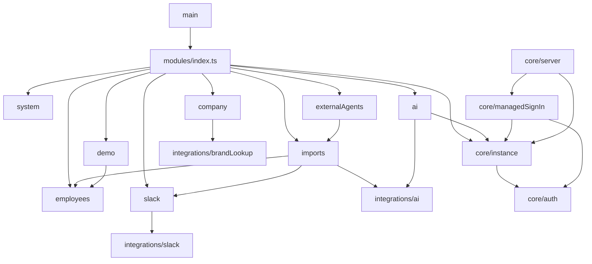
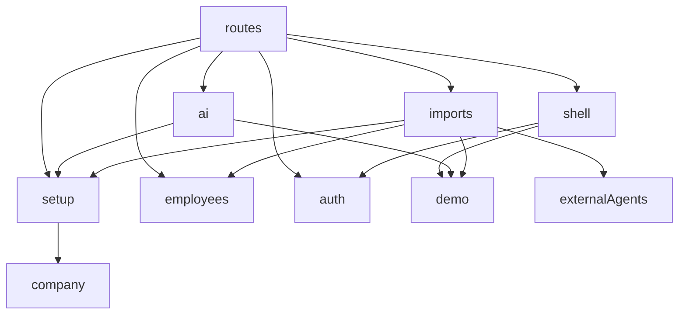

# Modules

What each top-level module offers and what it depends on. `importRules.json` ([API](../packages/api/importRules.json), [web](../packages/web/importRules.json)) is the source of truth for the imports; this map explains them and changes with them ([RULE3](code-quality.md#modules-and-files)). The layers inside a module are in [architecture §1](architecture.md#1-shape-of-the-system).

## API

Every module also uses the core services (`db`, `events`, `graphql`, `security`, `applicationError`, `logger`, and where needed `files`, `jobs`, `pagination`, `secrets`) and `utils`.

### Modules (`src/modules/`)

Each exports one factory that returns its manifest (SDL, resolvers, routes, events, jobs); `createModules` in `modules/index.ts` builds them all and hands self-hosted setup the demo's start and reset.

| Module           | Offers                                                                                                                                              |
| ---------------- | --------------------------------------------------------------------------------------------------------------------------------------------------- |
| `company`        | The company's name and logo, suggested from the owner's email domain at setup; the logo route.                                                      |
| `employees`      | Creating and listing employees, their avatars, and the functions the import and the demo create employees through.                                  |
| `imports`        | The import: Slack and staff-file sources, mapping, review, setup approve, setup reset and the demo start; photo and file routes.                    |
| `ai`             | How files are read with AI: the owner's choice of model at setup, checked before it is saved, and `decisions`, which every AI request goes through. |
| `slack`          | The Slack connection and its encrypted token; `readSlackMembers` is the one way other modules read the workspace.                                   |
| `externalAgents` | The owner's external agent: one-time codes, sessions, waiting for dropped files and answering mapping questions, under `/api/external-agent`.       |
| `demo`           | The sample company (`prepareDemoFill`) and clearing it; owns no table.                                                                              |
| `system`         | The GraphQL face of `core/instance`: `setup` (read with `readSetup`), `me` and completing setup.                                                    |

### Core (`src/core/`)

| Module                          | Offers                                                                                                                                                                              |
| ------------------------------- | ----------------------------------------------------------------------------------------------------------------------------------------------------------------------------------- |
| `server`                        | `startServer`: Express, Apollo, health probes, deployment auth and the module manifests.                                                                                            |
| `moduleManifest`                | The contract between the core and a module: `ModuleManifest`, `ModuleDependencies`.                                                                                                 |
| `instance`                      | The `instance` row: setup steps, the setup session, owner, demo deadline, the stored AI choice, the self-hosted `DeploymentServer` and who a request is (`resolveSecurityContext`). |
| `managedSignIn`                 | The managed `DeploymentServer`: init by signed token and sign-in through the accounts service.                                                                                      |
| `auth`                          | Better Auth built from the deployment's settings, the deployment router, and its tables: `user` for foreign keys, and `authUserRepository` for the few writes outside Better Auth.  |
| `security`                      | `SecurityContext` and its checks (`requireOwnerOrSystem`, `requireSetupAccess`, …).                                                                                                 |
| `db`                            | The connection, migrations, `transact`/`Tx`, keyset conditions and unique-violation checks.                                                                                         |
| `events`                        | The in-process domain event bus; publishers declare events by merging into `DomainEvents`.                                                                                          |
| `jobs`                          | pg-boss jobs queued inside a transaction; modules declare them by merging into `Jobs`.                                                                                              |
| `files`                         | Stored files in Postgres: `storeFile`, `readFile`, `deleteFiles`, `sendFile`.                                                                                                       |
| `graphql`                       | Apollo set-up, schema merging, `mutationPayload`, `perRequest`, scalars, generated resolver types.                                                                                  |
| `pagination`                    | `paginate`: Relay connections over keyset queries; `parseSearch` for list search input.                                                                                             |
| `secrets`                       | The encryption key and cookie secret on disk, and `createSecretBox` for encrypted columns.                                                                                          |
| `env`                           | `loadEnv`: the validated environment and the `Deployment`.                                                                                                                          |
| `applicationError`              | `ApplicationError`: the error codes use cases report.                                                                                                                               |
| `logger`, `readiness`, `health` | Logging; `/readyz` state; the probe routes.                                                                                                                                         |

### Integrations (`src/integrations/`) and utils

| Module        | Offers                                                                                                                                |
| ------------- | ------------------------------------------------------------------------------------------------------------------------------------- |
| `ai`          | The decisions API (OpenRouter or Broccoli AI), masking personal data, checking an OpenRouter key.                                     |
| `brandLookup` | A company's name and logo from an email domain, or nothing when `BRAND_LOOKUP_URL` is unset.                                          |
| `slack`       | The Slack Web API client and the OAuth relay client.                                                                                  |
| `utils`       | Code that knows nothing about Broccoli: `fetchJson`, `fetchBytes`, image normalising, CSV and Excel parsing, dates, cookies, origins. |

## Web

Every feature also uses `apollo`, `i18n`, `components/ui` and the `lib/` helpers it lists.

| Module                                 | Offers                                                                                                                             |
| -------------------------------------- | ---------------------------------------------------------------------------------------------------------------------------------- |
| `routes`                               | Thin route files; the root route reads the session and gates setup.                                                                |
| `shell`                                | The app frame (`AppShell`, `LeftNav`, `WorkspaceMenu`), `AuthCard`, `PageHeader` and the not-found and unreachable pages.          |
| `features/setup`                       | The setup flow: the step table and its gates, `readSession`, `SetupLayout` and step forms, the company step and the owner account. |
| `features/ai`                          | The "Setup AI" step: choose Broccoli AI, an OpenRouter key or the external agent.                                                  |
| `features/imports`                     | The import step, the setup review step and the ready step, and setup reset.                                                        |
| `features/externalAgents`              | The external agent's prompt, its status pill and the files it has not picked up yet.                                               |
| `features/employees`                   | The employee directory, its list search and `Avatar`.                                                                              |
| `features/demo`                        | Starting the demo (`useStartDemo`), its banner and resetting it.                                                                   |
| `features/auth`                        | Sign-in, sign-out and the login search.                                                                                            |
| `features/company`                     | `uploadLogo`.                                                                                                                      |
| `apollo`                               | The Apollo client and `usePayloadMutation`.                                                                                        |
| `components/dataTable`, `lib/listPage` | The shared list table, and search, sort and paging in the URL.                                                                     |
